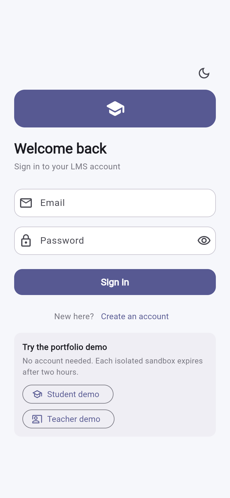
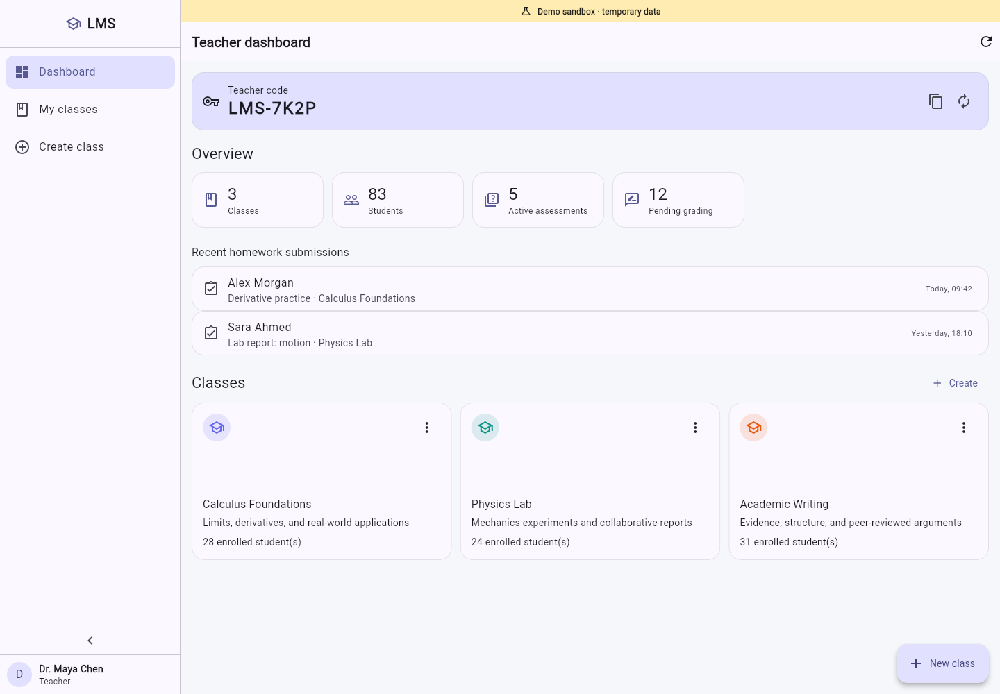
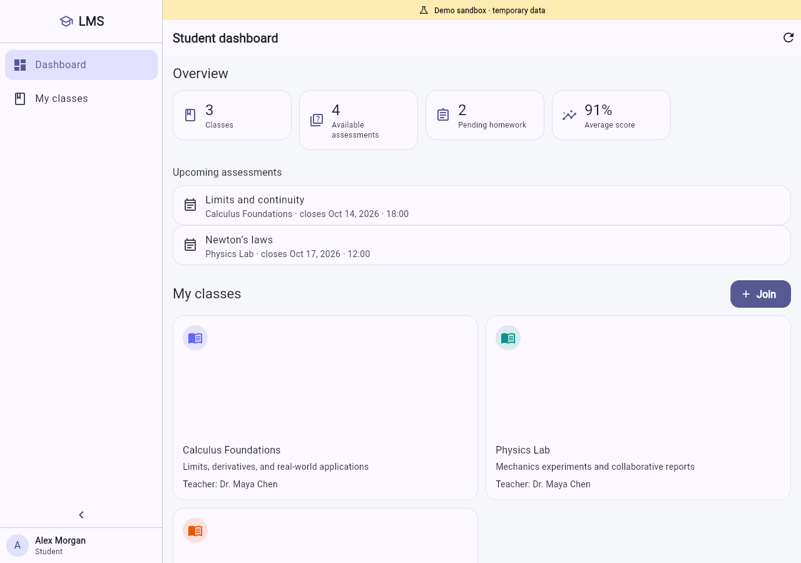
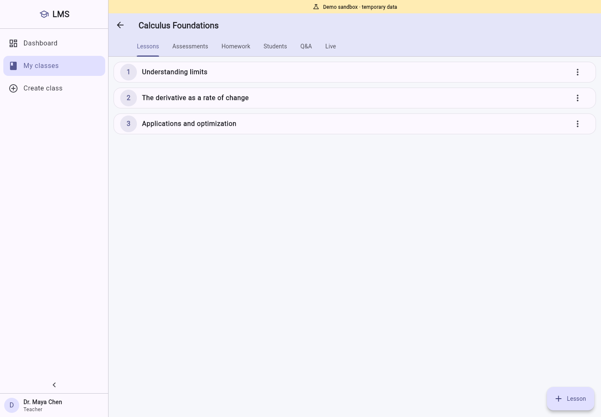
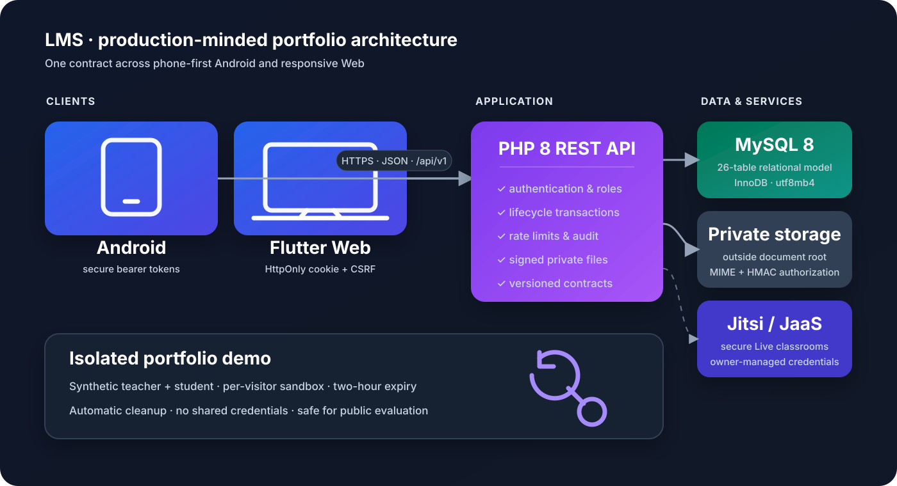

# LMS — Learning Management System

<p align="center">
  
</p>

[](https://github.com/seyedmohammadsinahosseini/lms/actions/workflows/ci.yml)


A phone-first learning management system built with **Flutter**, **PHP**, and
**MySQL/MariaDB**. LMS provides complete teacher and student workflows across
Android and responsive Web clients, backed by a versioned REST API with secure
sessions, private files, assessment lifecycles, and isolated portfolio demos.

> **Portfolio status:** the source, automated tests, CI, Web release path, and
> Android build path are complete. Public hosting and the signed production APK
> are being finalized; no live URL is claimed until end-to-end deployment checks
> pass.

## Product preview

<p align="center">
  
  &nbsp;
  
</p>

<p align="center">
  
  &nbsp;
  
</p>

## Highlights

### Teacher experience

- Create and manage classes, lessons, notes, videos, and private booklets
- Share renewable teacher codes and issue one-use enrollment grants
- Build versioned quizzes, tests, and exams with six question types
- Publish, close, schedule, and control answer-release policies
- Review attempts, manually grade essays, and release results
- Create homework with late/resubmission rules and immutable submission history
- Grade work, answer class questions, and manage Live sessions
- Use server-computed dashboards rather than placeholder statistics

### Student experience

- Join teachers securely and enroll in offered classes
- Browse lessons and authorized private learning files
- Take timed assessments with immutable question snapshots and attempt limits
- View results only when the configured release policy permits it
- Submit and resubmit homework with version history
- Participate in class Q&A and join Live sessions
- Use a responsive phone-first interface on Android or Web

### Portfolio demo

- One-click teacher or student demo without shared credentials
- A separate synthetic sandbox for every visitor
- Automatic two-hour expiry and opportunistic cleanup
- Rate-limited creation to protect free-hosting quotas
- No real student data in the public demonstration environment

## Architecture

<p align="center">
  
</p>

```text
Flutter Android / Flutter Web
             │ HTTPS + JSON (/api/v1)
             ▼
     PHP 8 REST API
       ├── MySQL 8 / MariaDB 10.6+
       ├── private upload storage
       ├── cookie + CSRF sessions (Web)
       ├── bearer tokens in secure storage (Android)
       └── Jitsi/JaaS integration for Live sessions
```

The Web client and API can be deployed on the same origin to minimize CORS and
cookie complexity. Android uses the same HTTPS API contract.

## Security design

- Password hashing with PHP's password API
- Hashed session tokens and role-based authorization on every protected route
- HttpOnly, Secure, SameSite cookies plus CSRF protection for Web
- Bearer tokens stored with the platform secure-storage API on Android
- Explicit production CORS allow-list; localhost is never auto-allowed
- Authentication, demo creation, and sensitive-operation rate limits
- Extension, MIME, and size allow-lists for uploads
- Random server-side filenames outside the public document root
- User-bound, five-minute HMAC download URLs
- Audit events for authentication and sensitive lifecycle operations
- Production Live rooms require owner-controlled JaaS credentials

See [SECURITY.md](SECURITY.md) for responsible disclosure and deployment notes.

## Quality evidence

| Check | Result |
|---|---:|
| PHP lifecycle/API contracts | **48 / 48 passed** |
| Backend security contracts | **22 / 22 passed** |
| Flutter unit/widget tests | **25 / 25 passed** |
| Flutter static analysis | **No issues found** |
| Fresh schema | **26 tables validated** |
| Preserving migration | **Validated against baseline data** |
| Flutter Web release | **Built in GitHub Actions** |
| Phone-viewport browser smoke | **Passed** |

CI validates PHP syntax, fresh schema import, preserving migration, API and
security suites, Flutter analysis/tests, Web release, Android debug compilation,
and a real-browser boot smoke test.

## Technology stack

| Layer | Technology |
|---|---|
| Mobile & Web | Flutter / Dart, Provider, Material 3 |
| Native target | Android 8.0+ (SDK 26), JDK 21, Android SDK 36 |
| Backend | PHP 8.2+, PDO MySQL, versioned JSON REST API |
| Data | MySQL 8 or MariaDB 10.6+, InnoDB, utf8mb4 |
| Live classroom | Jitsi Meet SDK; JaaS credentials in production |
| Testing | Flutter Test, shell API suites, Playwright browser smoke |
| Delivery | GitHub Actions, signed universal APK workflow, hosting bundles |

## Repository map

```text
backend/                         PHP API, schema, and migrations
backend/api/v1/                  stable versioned public endpoints
lms_flutter/                     Android and responsive Web client
tools/api_test.sh                48-check lifecycle regression suite
tools/api_security_test.sh       22-check authorization/security suite
tools/package_deployment.sh      provider-neutral deployment bundle
tools/package_serv00.sh          Serv00 deployment adapter
.github/workflows/ci.yml         full validation and build pipeline
.github/workflows/release-android.yml
                                 signed APK verification/release pipeline
docs/                            deployment, Android, and run guides
IMPLEMENTATION_PROGRESS_FA.md    current implementation status (Persian)
```

## Local development

### Requirements

- PHP 8.2+ with `pdo_mysql`, `mbstring`, and `fileinfo`
- MySQL 8 or MariaDB 10.6+
- Flutter 3.47.6 (or a compatible newer stable release)

### 1. Prepare the database and private configuration

```bash
mysql -u root -p -e \
  'CREATE DATABASE lms CHARACTER SET utf8mb4 COLLATE utf8mb4_unicode_ci'
mysql -u root -p lms < backend/schema.sql
mkdir -p config "$HOME/lms-storage/uploads"
cp backend/.env.example config/lms.env
```

For local development, edit `config/lms.env`:

```dotenv
LMS_APP_ENV=local
LMS_APP_KEY=replace-with-a-long-random-value
LMS_DB_HOST=127.0.0.1
LMS_DB_PORT=3306
LMS_DB_NAME=lms
LMS_DB_USER=root
LMS_DB_PASS=
LMS_PUBLIC_BASE_URL=http://127.0.0.1:8080
LMS_STORAGE_PATH=/absolute/path/to/lms-storage/uploads
LMS_ALLOWED_ORIGINS=http://127.0.0.1:3000,http://localhost:3000
LMS_TRUST_PROXY=0
LMS_DEMO_MODE=1
LMS_ALLOW_TEACHER_REGISTRATION=1
LMS_LIVE_PROVIDER=jitsi
```

### 2. Start the API

```bash
php -S 0.0.0.0:8080 -t backend
curl http://127.0.0.1:8080/api/v1/health.php
```

### 3. Start Flutter Web

```bash
cd lms_flutter
flutter pub get
flutter run -d chrome --web-port=3000 \
  --dart-define=LMS_API_BASE=http://127.0.0.1:8080/api/v1 \
  --dart-define=LMS_APP_MODE=development
```

For an Android emulator, use
`http://10.0.2.2:8080/api/v1`. Production builds require HTTPS.

## Run the checks

```bash
# PHP syntax
find backend -type f -name '*.php' -print0 | xargs -0 -n1 php -l

# Each API suite needs a clean schema
LMS_DB_NAME=lms_test bash tools/api_test.sh
LMS_DB_NAME=lms_security bash tools/api_security_test.sh

# Flutter
cd lms_flutter
flutter analyze
flutter test
```

## Database upgrades

`backend/migrations/2026-10-02_full_remediation.sql` upgrades the legacy schema
while preserving identifiers and existing records. Never run it first against
the only copy of production data:

1. stop writes and make a full backup;
2. restore the backup into staging;
3. run the migration and both API suites;
4. inspect critical users, classes, files, and attempts;
5. only then schedule the production migration.

Recovery is performed by restoring the backup; the migration is intentionally
one-way.

## Deployment and Android release

- [Free/shared-hosting deployment guide](docs/استقرار-رایگان.md)
- [Signed Android release guide](docs/انتشار-اندروید.md)
- [Local and Windows/XAMPP guide](docs/راهنمای-اجرا.md)
- [Physical Android phone guide](docs/اجرا-روی-گوشی.md)
- [Browser preview guide](docs/پیش‌نمایش-مرورگر.md)

A release APK must use the owner-controlled application ID
`io.github.seyedmohammadsinahosseini.lms` and a durable, backed-up signing key.
The repository never falls back to debug signing for a release artifact.

## Scope and current limitations

- Native iOS is not claimed; the responsive Web client can run in iOS browsers.
- Secure production Live sessions require external JaaS credentials.
- A public free-hosting demo is for synthetic portfolio data, not sensitive or
  high-traffic production use.
- The final signed APK requires an owner-controlled keystore and GitHub secrets.

## Author

**Seyed Mohammad Sina Hosseini**

- [GitHub](https://github.com/seyedmohammadsinahosseini)
- [LinkedIn](https://www.linkedin.com/in/seyedmohammadsinahosseini)
- [Website](https://seyedmohammadsinahosseini.ir/)

## License

This project is available under the [MIT License](LICENSE).
